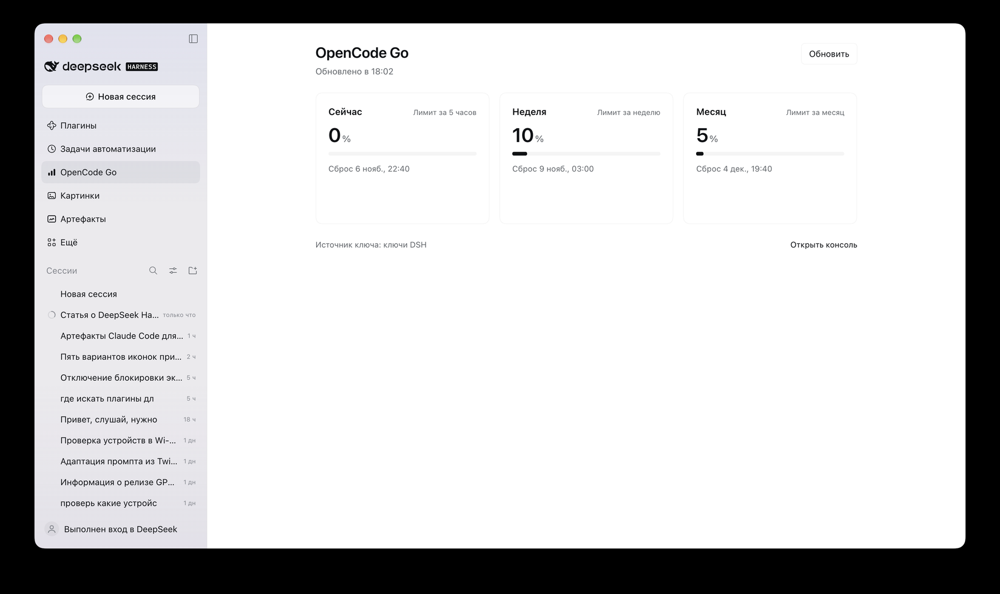
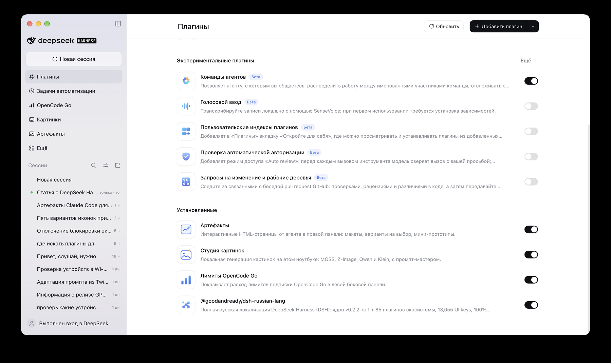

<div align="center">

# 📊 OpenCode Go Usage for DeepSeek Harness

**Лимиты подписки OpenCode Go всегда перед глазами — прямо в боковой панели DSH.**

[](LICENSE)


*English: a plugin for DeepSeek Harness ([details below](#english)) that adds an "OpenCode Go" item to the left sidebar with your 5-hour, weekly and monthly usage.*

</div>



## 🎯 Что это

В левой панели DSH появляется пункт **OpenCode Go**. Нажал, и видно, сколько лимита уже потрачено и когда он обнулится:

| Окно | Что показывает |
|---|---|
| ⏱ **Сейчас** | расход за последние 5 часов |
| 📅 **Неделя** | расход за неделю |
| 🗓 **Месяц** | расход за месяц |

У каждого окна есть процент, полоса заполнения и время сброса. Когда лимит исчерпан, плашка так и пишет: «Лимит исчерпан · сброс …».

Ещё в плагине:

- 🔄 данные обновляются сами раз в минуту, есть кнопка «Обновить»
- 🔑 ключ искать не нужно: плагин сам берёт его из настроек DSH, переменной окружения, связки ключей macOS или из входа в opencode
- 🔒 ключ остаётся на стороне сервера DSH и в браузерную часть не попадает
- 🌍 интерфейс на русском, английском и китайском

## 🚀 Установка

1. Скачай плагин:

   ```bash
   git clone https://github.com/ungurenko/dsh-opencode-go-usage.git
   ```

2. Открой `package.json` своего профиля DSH (например `~/.dsh/profiles/<профиль>/package.json`) и добавь две записи. Путь после `link:` замени на свой:

   ```json
   {
     "dependencies": {
       "@local/dsh-opencode-go-usage": "link:/полный/путь/до/dsh-opencode-go-usage"
     },
     "dsh": {
       "profile": {
         "bundles": ["@local/dsh-opencode-go-usage"]
       }
     }
   }
   ```

   Если в `bundles` уже есть другие плагины, просто добавь строку в конец списка.

3. В папке профиля выполни `pnpm install`, затем перезапусти DSH.

4. Проверь: в левой панели появился пункт **OpenCode Go**, а в «Плагины» → «Установленные» есть «Лимиты OpenCode Go».



## 🔑 Откуда берётся ключ

Плагин перебирает источники по порядку и берёт первый найденный:

1. настройка `apiKey` в конфиге плагина
2. учётные данные DSH под именем `OPENCODE_GO_API_KEY`
3. переменная окружения `OPENCODE_GO_API_KEY`
4. связка ключей macOS, запись `opencode-go-api-key`
5. вход в opencode (`~/.local/share/opencode/auth.json`)

Если ты уже вошёл в opencode на этом компьютере, всё заработает без настройки. Под панелью плагин показывает, откуда взял ключ.

## ⚙️ Настройки (необязательно)

Параметры задаются в `config` плагина (`cordis.patch.yml`):

| Параметр | По умолчанию | Зачем |
|---|---|---|
| `apiKey` | нет | ключ прямо в конфиге |
| `apiKeyRef` | `OPENCODE_GO_API_KEY` | имя ключа в DSH и в переменных окружения |
| `workspaceId` | пусто | id рабочего пространства, если аккаунту нужен заголовок `x-opencode-org-id` |
| `baseUrl` | `https://opencode.ai` | адрес консоли OpenCode |
| `timeoutMs` | `15000` | сколько ждать ответ |
| `keychainService` | `opencode-go-api-key` | имя записи в связке ключей macOS |

## ❓ Частые вопросы

**Панель пишет «No OpenCode API key found».** Ключ не нашёлся ни в одном из пяти мест. Войди в opencode или добавь `OPENCODE_GO_API_KEY` в учётные данные DSH.

**«This key has no Go subscription».** Ключ рабочий, но подписки OpenCode Go на этом аккаунте нет.

**Пункта нет в боковой панели.** Проверь, что плагин включён в «Плагины» и что DSH перезапущен после `pnpm install`.

## ⚙️ Для разработчиков

```
├── index.js            серверная часть: маршрут /api/opencode-go/usage, поиск ключа, запрос к opencode.ai
├── client.js           браузерная часть: пункт и страница в sidebar (React через ModuleLoader)
├── cordis.patch.yml    регистрация плагина в профиле
├── locale/             ru / en / zh
└── icon.svg
```

Браузер вызывает серверный маршрут DSH, тот читает ключ и обращается к `GET https://opencode.ai/zen/go/v1/usage` с заголовком `Authorization: Bearer <key>`. Ответ приводится к трём окнам `rolling`, `weekly`, `monthly` с полями `percent`, `limited`, `resetsAt`.

Версия плагина 1.0.0, проверен на DeepSeek Harness 0.2.2-rc.1.

## English

A DeepSeek Harness (DSH) plugin that adds an **OpenCode Go** item to the left sidebar. It shows how much of your 5-hour, weekly and monthly allowance is used and when each window resets. Refreshes every minute.

**Install:** clone the repo, add `"@local/dsh-opencode-go-usage": "link:/path/to/dsh-opencode-go-usage"` to `dependencies` and `"@local/dsh-opencode-go-usage"` to `dsh.profile.bundles` in your profile's `package.json`, run `pnpm install`, restart DSH.

**API key** is looked up in this order: plugin config `apiKey`, DSH credential `OPENCODE_GO_API_KEY`, environment variable of the same name, macOS Keychain item `opencode-go-api-key`, then your opencode sign-in. The key never reaches the browser.

---

<div align="center">

**MIT** · сделано для сообщества DeepSeek Harness 🐋

</div>
